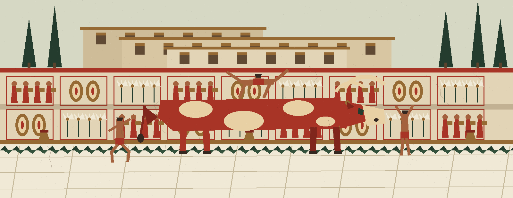
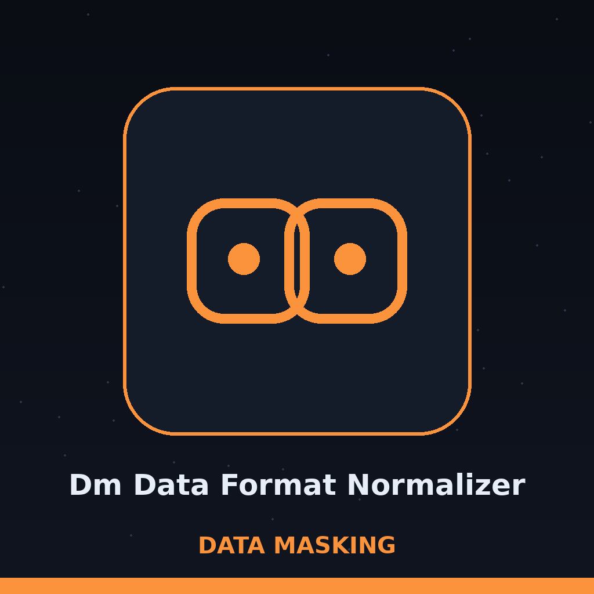
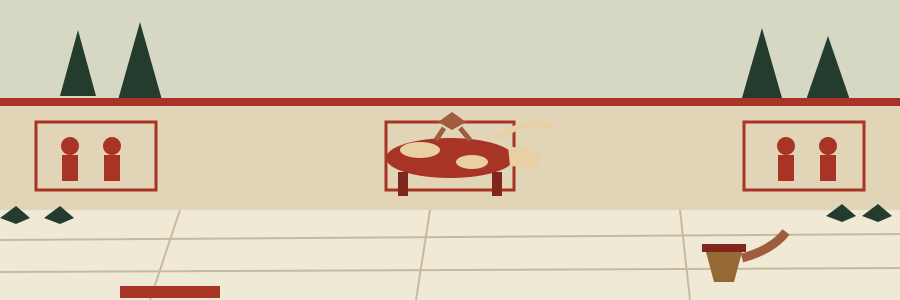

# dm-data-format-normalizer

Title block: the name above is cut as a stone plaque at the foot of a wall, set in Bytesized in roman red on marble white, a cypress rule beneath it, and the small bull head mark at the left of this first heading only. Later headings keep the plaque and rule treatment without the head.

# dm-data-format-normalizer
Consistently formats data, such as phone numbers or dates, to a predefined standard. This makes identifying true values more difficult by removing distinguishing formatting characteristics that can act as identifiers. Handles data type conversions where necessary for normalization. - Focused on Tools designed to generate or mask sensitive data with realistic-looking but meaningless values

## Install
`git clone https://github.com/ShadowGuard-AI/dm-data-format-normalizer`

## Usage
`python3 main.py [options]`

> Wall label: date work cannot start without an input format. The incoming arrangement has to be declared before a date can be normalized, while the outgoing arrangement and the logging level each carry a stated default.

## Parameters
- `-h`: Show help message and exit
- `--type`: The type of data to normalize.
- `--input`: The input data to normalize.
- `--input_format`: The input date format (required for date normalization). Example: '%m/%d/%Y'
- `--output_format`: The output date format (default: '%Y-%m-%d')
- `--log_level`: Set the logging level (default: INFO)

> Wall label: the type control arrives with no printed list of kinds beside it, and the input control states no shape for the data, so a caller learns the accepted kinds and shapes from the program, not from this page.

> Wall label: the ownership lines in this README name a different organisation twice, once in the install line and once in the licence line. That fact is stated here in the open, and the lines themselves are left exactly as printed.

## License
This project is released under the MIT License. See the [LICENSE](LICENSE) file for details.

## Wall labels gathered in the court

The buttons of this re-skin read Normalize to the Standard. Its type field label reads Kind of Data. Its input field label reads Data to Normalize. Its headings read One Standard Dress, Quirks Left at the Gate, Dates Need Their Incoming Shape, and Kinds the Page Will Not Guess. The light retreats off the wall at the close: the vault stays unfinished forever, because the work of this tool is a crossing that repeats with every value, and the painted court is left lit at its edge with the plaque readable at its foot.
